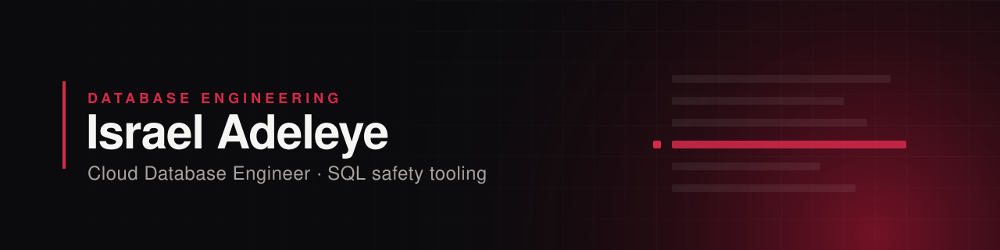

  

<h1 align="center">Israel Adeleye</h1>

  <strong>Cloud Database Engineer</strong> · building SQL safety tooling 
  MySQL · PostgreSQL · SQL Server · AWS · Google Cloud

  <a href="#about-me">About me</a> ·
  <a href="#tech-stack">Tech stack</a> ·
  <a href="#featured-projects">Featured projects</a> ·
  <a href="#github-activity">GitHub activity</a> ·
  <a href="#currently-focused-on">Currently focused on</a> ·
  <a href="#connect">Connect</a>

 

## About me

**I'm a Database Engineer building reliable, high-performance data systems across MySQL, PostgreSQL, and SQL Server in cloud environments.**

I design production-grade databases, optimize performance bottlenecks, and deploy scalable infrastructure on AWS and GCP. I work with Python and Linux to automate database operations and bridge the gap between traditional database management and modern cloud-native practices. I'm passionate about database internals, constantly learning new technologies, and solving complex data challenges that drive business results.

 

## Tech stack

**Databases**

  
  
  
  

**Languages and data**

  
  
  
  

**Cloud and tools**

  
  
  
  
  
  

The tools I work with. The stack used in each project is listed with the project below.

 

## Featured projects

<table>
<tr>
<td>

### [MySQL DBA Validator](https://github.com/realspinn/mysql-dba-validator)

*How risky is this SQL, and how sure are we about that?*

A tool for reviewing MySQL SQL from database tickets before it is run. For each statement it gives a risk level and score, a confidence level, the findings behind the score and a review checklist. It can add read-only evidence from a database (execution plans and table metadata), and it never runs the SQL you submit. Scoring is rule-based and deterministic: no AI model makes the risk decision.

**Worth a look:** a DBA gets a review that says what it knows, and what it does not, before the SQL reaches a real database. It ships as a portable Windows app and an unsigned macOS (Apple Silicon) build.

[Repository](https://github.com/realspinn/mysql-dba-validator) ·
[Latest release](https://github.com/realspinn/mysql-dba-validator/releases/latest) ·
[Contributing guide](https://github.com/realspinn/mysql-dba-validator/blob/main/CONTRIBUTING.md)

See a results page

 

</td>
</tr>
</table>

<table>
<tr>
<td>

#### [SQL Data Warehouse](https://github.com/realspinn/sql-data-warehouse-project)

A warehouse built from raw ERP and CRM files using the Medallion architecture (bronze, silver, gold), with ETL load procedures and a star schema for analytics.

**Worth a look:** the [load procedures](https://github.com/realspinn/sql-data-warehouse-project/tree/main/scripts) for each layer and the [data quality checks](https://github.com/realspinn/sql-data-warehouse-project/tree/main/tests).

</td>
</tr>
<tr>
<td>

#### [BankDB](https://github.com/realspinn/BankDB-SQL-Project)

A normalised banking schema for customers, accounts, transactions and loans, with stored procedures, indexing and analysis queries.

**Worth a look:** the [indexing script](https://github.com/realspinn/BankDB-SQL-Project/blob/main/BankDB_indexes.sql) next to the [analysis queries](https://github.com/realspinn/BankDB-SQL-Project/blob/main/BankDB_queries.sql) it supports.

</td>
</tr>
<tr>
<td>

#### [NetflixDB](https://github.com/realspinn/NetflixDB-SQL)

A streaming-subscription database for users, plans and watch history, with constraints, stored procedures, window functions and CTEs.

**Worth a look:** the [stored procedures](https://github.com/realspinn/NetflixDB-SQL/blob/main/StoredProcedures/Netflix_StoredProcedures.sql) and the [window function and join queries](https://github.com/realspinn/NetflixDB-SQL/blob/main/sql/WindowFunctionsAndJoins.sql).

</td>
</tr>
</table>

<a href="https://github.com/realspinn?tab=repositories">All repositories →</a>

## GitHub activity

  
  

 

## Currently focused on

- **MySQL DBA Validator** is pre-1.0 and developed in the open. Contributions and feedback from DBAs are welcome: see the [contributing guide](https://github.com/realspinn/mysql-dba-validator/blob/main/CONTRIBUTING.md) or start a conversation in [the project's Discussions](https://github.com/realspinn/mysql-dba-validator/discussions).
- **Keel** is an early-stage concept for chronic-care and medication management. It is not public yet.

 

## Connect

  
  

 

<em>"Stay consistent. Success will chase you."</em> — IAO

